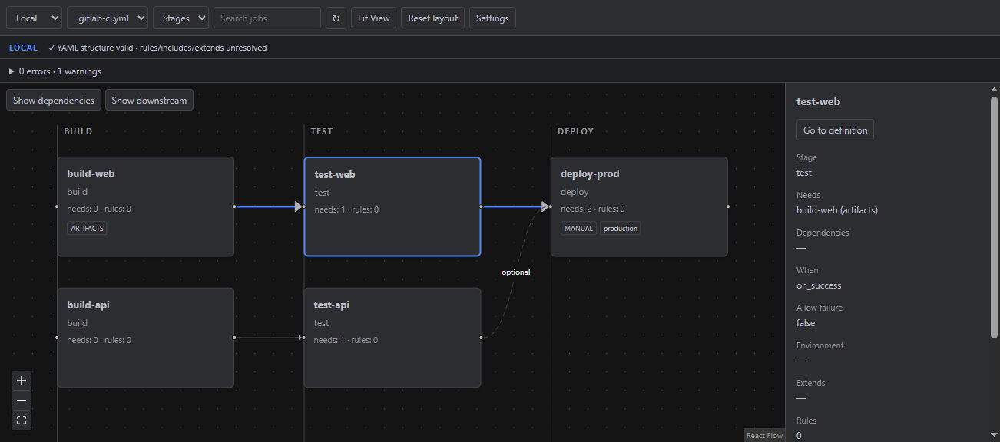

# GitLab CI Graph

JetBrains IDE plugin for exploring GitLab CI/CD pipelines inside the IDE.

Plugin ID: `space.sirok.gitlab-ci-graph` · Vendor: Sirok.

## Features

- Automatically discovers `.gitlab-ci.yml` and `.gitlab-ci.yaml`, with a project-level file selection.
- Interactive React Flow graph in a JCEF Tool Window; Stages columns and Dagre DAG layout.
- Explicit `needs` arrows, dashed optional edges, artifact metadata, manual/allow-failure/trigger/environment badges.
- Search (Enter focuses the next match, Escape clears), zoom, pan, minimap, Fit View and reset layout.
- Job details, upstream/downstream focus and context menu.
- Double-click opens the exact local job definition, including local include files.
- Refresh while editing YAML, including unsaved local include files, with a 400 ms debounce; saved/external VFS changes are also tracked. Light/dark IDE theme updates.
- GitLab CI Lint integration, validation errors/warnings, configurable server/project/ref and PasswordSafe token storage.

### Local mode

Works offline without credentials. Uses a YAML node parser, preserving source locations and expanding local includes within the project. Shows declared structure, **not a compiled or validated GitLab pipeline**. Rules are counted but not executed; hidden templates are omitted and `extends` is shown in details. Stage columns never invent dependency arrows.

### GitLab resolved mode

Calls `POST /api/v4/projects/:id/ci/lint` with current selected file content (including unsaved editor changes), `dry_run: true`, `include_jobs: true` and the selected ref. Returned `jobs` are authoritative; jobs excluded by the server are absent. `merged_yaml` supplements details. GitLab resolves includes using its repository/ref context: **unsaved/uncommitted local include edits are not uploaded**. Local locations are matched by job name; generated/external jobs may have no navigable local definition.

## Screenshots

Actual JCEF view captured from the running IntelliJ IDEA sandbox, with `test-web` selected:



The fixture in `examples/.gitlab-ci.yml` is the source of this graph. The capture contains the plugin's embedded browser area, not an independently hosted website.

## Requirements

- IntelliJ IDEA, WebStorm or a compatible JetBrains IDE 2025.3.1+ with YAML and JCEF modules enabled.
- JetBrains Runtime with JCEF. An alternate runtime without JCEF displays an explanatory fallback.
- Development: JDK 21, Node.js 22.12+ (tested build environment: Node 24), npm, internet for initial dependency downloads.
- Gradle wrapper 9.0.0, IntelliJ Platform Gradle Plugin 2.19.0, Kotlin 2.2.20; SDK 2025.3.1.

## Installation

Build the ZIP, then use **Settings → Plugins → gear → Install Plugin from Disk** and select `build/distributions/gitlab-ci-graph-0.1.0.zip`. Open **View → Tool Windows → GitLab CI Graph**.

## Development

Open this directory as a Gradle project using JDK 21. Kotlin packages separate model, parsing, API, settings, navigation and IDE presentation. Frontend source is under `frontend/src`.

Standalone frontend build:

```sh
cd frontend
npm install
npm run build
npm test
```

`npm run dev` is available for frontend development; IDE actions require the JCEF bridge. Production needs no dev server. `package-lock.json` pins the dependency tree.

For an optional integration smoke test against the actual embedded JCEF browser:

```sh
./gradlew runIde -PjcefDebugPort=9222
# In another terminal, after the Tool Window has loaded:
node scripts/jcef-smoke.mjs
```

The diagnostic port is opt-in and used only in the development sandbox. This test checks graph counts, Fit View bounds, search, layouts, details and dependency focus, and captures the running view. See [verification record](docs/VERIFICATION.md).

## Build

```sh
./gradlew test
./gradlew buildPlugin
./gradlew verifyPluginStructure
./gradlew verifyPlugin
```

On Windows use `gradlew.bat`. Gradle automatically runs `npm ci` and the Vite build before copying the resulting single-file HTML into plugin resources. `test` also runs frontend transformation tests. `verifyPlugin` checks the currently targeted IDE and may download verification dependencies. The requested Plugin ID starts with `space`, which triggers JetBrains' template-word naming rule; only `TemplateWordInPluginId` is muted for binary verification. The standalone structure checker still reports this naming warning. Publication acceptance for that ID is not asserted. No publishing task is invoked automatically.

## CI builds and releases

Both [GitLab CI](.gitlab-ci.yml) and [GitHub Actions](.github/workflows/ci.yml) run release-tooling tests, plugin/frontend tests and `buildPlugin` on pushes and merge/pull requests. Tagged releases also run `verifyPlugin`; publishing only starts after all checks pass. Build artifacts and test reports are retained for 14 days.

Push a version tag to create a release automatically:

```sh
git tag v0.2.0
git push origin v0.2.0
```

Use `v0.2.0-rc.1` for a prerelease (marked as such on GitHub). The version is taken from the tag and passed to Gradle as `-PpluginVersion=0.2.0`; normal builds use `pluginVersion` from `gradle.properties`. Tags must use SemVer without build metadata. Commit the desired changes before creating the tag. Tags are treated as immutable: an existing published release is not overwritten; delete an incomplete release deliberately before retrying its release job.

Update [CHANGELOG.md](CHANGELOG.md) before tagging. Release notes use the matching version section, fall back to `Unreleased`, and always include non-merge commits since the preceding reachable version tag. First-release notes include all commits. Both providers publish the ZIP, `SHA256SUMS` and `RELEASE_NOTES.md`; the notes also become the release description.

- GitHub: built-in `GITHUB_TOKEN`, with `contents: write` only in the release job. No PAT is needed. Official actions are pinned to verified commit SHAs. Hosted Ubuntu 24.04 runners are used; fork PRs only receive read permissions.
- GitLab: built-in `CI_JOB_TOKEN` uploads assets to this project's Generic Package Registry and creates a release with permanent package links. No PAT is needed. Enable the Package Registry, permit the triggering user to create releases/upload packages, and keep release packages outside automated cleanup policies. The Docker runner needs internet access, about 8 GB RAM and sufficient disk for the IntelliJ SDK. The build image supplies JDK 21; Node 24.13.0 is downloaded from nodejs.org with SHA-256 verification. Self-hosted API URLs come from `CI_API_V4_URL`.

These pipelines publish repository releases only; they do not invoke `publishPlugin` or upload to JetBrains Marketplace. CI tests for the scripts can also be run locally:

```sh
node --test scripts/ci/*.test.mjs
node scripts/ci/prepare-release.mjs 0.1.0
```

The second command expects the matching ZIP in `build/distributions` and writes a release bundle under `build/release`. Hosted pipelines and live publication need a pushed repository and were not executed in the local development environment.

## Running IDE sandbox

```sh
./gradlew runIde
```

Open the `examples` directory inside the sandbox IDE. Open the Tool Window, confirm three stages and explicit arrows, double-click `test-web`, edit/save a YAML dependency, and check refresh. Switch the IDE theme, search for `deploy`, and test Fit View. Build/test success alone does not prove this interactive checklist passed.

## GitLab integration

Open **Settings → Tools → GitLab CI Graph**. Set URL (for example `https://gitlab.com`), project path or numeric ID, default ref and token. **Test connection** checks project access. The first Git remote in `.git/config` may be offered as a suggestion; it is applied only when you click **Use suggestion**. Switch the toolbar to GitLab mode. The ref field accepts a branch, tag or commit supported by GitLab.

The token is stored only in JetBrains PasswordSafe, keyed by instance/project. A blank unchanged password field retains the existing token. Type a replacement to update it or select **Remove saved token** to delete it. Tokens are never sent to JCEF or logged. All HTTP runs in Kotlin on a background thread, uses certificate verification, timeouts, and refuses redirects to avoid forwarding credentials to another endpoint.

## Self-hosted GitLab

Set the full instance base URL, including any deployment subpath. HTTPS is recommended. Configure a valid certificate/JVM trust store for private CAs; the plugin does not disable TLS verification. SSH and HTTPS remote URL suggestions support nested group paths. SSH remote suggestions assume the HTTPS UI is served on the default HTTPS port; review before use.

## Token permissions

Use a Personal Access Token with access to the selected project and the API permissions required by your GitLab version for CI Lint dry-run (typically `api`). Check your server policy. The plugin does not create or run real pipelines. GitLab documentation: [CI Lint API](https://docs.gitlab.com/api/lint/).

## Architecture

```text
Local YAML files ─ LocalPipelineParser ─┐
                                      ├─ PipelineModel ─ JBCefJSQuery bridge ─ React Flow
GitLab CI Lint ─ GitLabClient ──────────┘                       │
                         PasswordSafe                         └─ JobNavigation → editor
```

Gson serializes the model; frontend never receives raw YAML or credentials. SnakeYAML node composition handles YAML syntax/tags without constructing arbitrary application objects. Include traversal is bounded and checked against the real project path. A single disposable background executor serializes work; generation IDs prevent stale results replacing newer selections. Browser, query and message-bus subscriptions follow the content lifecycle.

## Known limitations

- Local mode does not implement GitLab inheritance, rule evaluation, matrix expansion, remote/project/component includes or conditional include evaluation. Literal local includes are supported; glob/variable include paths are reported as unavailable.
- `pages` is treated as a reserved global keyword as requested; modern GitLab configurations using a job literally named `pages` should use GitLab mode.
- Duplicate job definitions use the later complete definition; local partial-map GitLab merge semantics and YAML `<<` inheritance are not emulated.
- Local valid indicator means readable YAML structure only. Use GitLab mode for authoritative pipeline validation.
- Child pipeline jobs are marked but child graphs are not recursively fetched. External/project needs appear in details but do not create false local edges.
- Caret-to-graph selection and excluded-job display are not implemented.
- Ref selection is a text field; branches are not enumerated. Remote detection reads `.git/config` and does not resolve worktree gitdir files.
- HTTP uses JVM networking/trust configuration; IDE-specific proxy settings are not yet integrated.
- Layout reset recomputes positions. Dragged node positions are not persisted. No assertion is made that all future IDE versions are compatible; run Plugin Verifier for your target.
